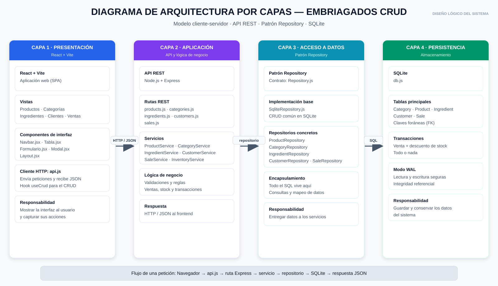
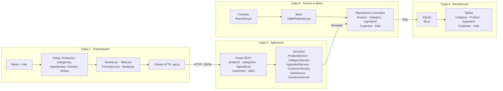

# Arquitectura por capas — EMBRIAGADOS CRUD

Este documento describe la arquitectura implementada en el proyecto y su relación con el
diagrama de arquitectura por capas.



## Resumen

El sistema usa una arquitectura por capas con separación de responsabilidades:

| Capa | Responsabilidad | Implementación |
| --- | --- | --- |
| 1. Presentación | Mostrar la interfaz y capturar acciones del usuario | React + Vite, vistas, componentes, `api.js` |
| 2. Aplicación | Procesar solicitudes y aplicar reglas de negocio | Express, rutas REST y servicios |
| 3. Acceso a datos | Encapsular las consultas y el mapeo de datos | Patrón Repository sobre SQLite |
| 4. Persistencia | Guardar y conservar la información | SQLite, `db.js`, tablas y transacciones |

El flujo de una petición es:

```text
Navegador → api.js → ruta Express → servicio → repositorio → SQLite
                                                        ↓
Navegador ← JSON ← ruta Express ← servicio ← repositorio ← resultado
```

## Diagrama



## Capa 1 — Presentación

Archivos principales:

```text
frontend/src/
├── api.js                  # cliente HTTP (fetch) hacia /api
├── hooks/useCrud.js        # estado y operaciones CRUD reutilizables
├── components/
│   ├── Navbar.jsx          # encabezado y menú de navegación
│   ├── Tabla.jsx           # tabla reutilizable
│   ├── Formulario.jsx      # formulario y campos reutilizables
│   ├── Modal.jsx           # ventana modal
│   └── Layout.jsx          # estructura general de la aplicación
└── pages/
    ├── Productos.jsx
    ├── Categorias.jsx
    ├── Ingredientes.jsx
    ├── Clientes.jsx
    └── Ventas.jsx
```

Responsabilidad: presentar la información, validar datos a nivel de formulario y enviar
peticiones HTTP al backend. No contiene SQL ni reglas de negocio del servidor.

## Capa 2 — Aplicación

Archivos principales:

```text
backend/
├── app.js                  # configura Express y monta las rutas
├── container.js            # conecta repositorios y servicios
├── routes/
│   ├── createCrudRouter.js # router REST reutilizable
│   ├── products.js
│   ├── categories.js
│   ├── ingredients.js
│   ├── customers.js
│   └── sales.js
└── services/
    ├── CrudService.js
    ├── ProductService.js
    ├── CategoryService.js
    ├── IngredientService.js
    ├── CustomerService.js
    ├── InventoryService.js
    └── SaleService.js
```

Responsabilidad: recibir la petición HTTP, validar los datos, aplicar las reglas de negocio y
delegar el acceso a datos a un repositorio. Las rutas no contienen SQL.

### Servicios destacados

- `SaleService`: valida la venta, calcula el total y coordina la transacción.
- `InventoryService`: valida la disponibilidad, descuenta stock al vender y lo restaura al
  eliminar una venta.
- `CrudService`: comportamiento común de listar, obtener, crear, editar y eliminar.

## Capa 3 — Acceso a datos

```text
backend/repositories/
├── Repository.js           # contrato abstracto
├── SqliteRepository.js     # implementación base para SQLite
├── ProductRepository.js
├── CategoryRepository.js
├── IngredientRepository.js
├── CustomerRepository.js
└── SaleRepository.js
```

El patrón Repository permite:

- mantener todo el SQL en un solo lugar;
- cambiar la fuente de datos sin modificar los servicios;
- probar la lógica de negocio con repositorios simulados;
- evitar que las rutas conozcan detalles de la base de datos.

## Capa 4 — Persistencia

Archivo principal: `backend/db.js`.

- Motor: SQLite con `better-sqlite3`.
- Tablas: `Category`, `Product`, `Ingredient`, `Customer`, `Sale`.
- Claves foráneas habilitadas (`foreign_keys = ON`).
- Modo WAL para lectura y escritura.
- Transacciones para operaciones que afectan varias tablas.

## Flujo de una venta

1. El usuario selecciona un producto y una cantidad en `Ventas.jsx`.
2. `api.js` envía `POST /api/sales`.
3. `routes/sales.js` delega en `SaleService`.
4. `SaleService` valida los datos y abre una transacción.
5. `InventoryService` obtiene el producto y verifica el stock.
6. `SaleService` calcula `total = cantidad × precio`.
7. `SaleRepository` inserta la venta.
8. `InventoryService` descuenta el stock.
9. La transacción confirma todos los cambios y devuelve la venta en JSON.
10. Si algo falla, SQLite revierte la venta y el descuento de stock.

Al eliminar una venta se ejecuta el proceso inverso: se elimina el registro y se restaura el
stock del producto.

## Pruebas

Las pruebas automatizadas cubren:

- estado de la API;
- CRUD de Productos, Categorías, Ingredientes y Clientes;
- creación de ventas y cálculo del total;
- validación de cantidad y stock;
- descuento de stock al vender;
- restauración de stock al eliminar una venta;
- venta inválida sin cambios en el inventario;
- venta de todo el stock disponible;
- respuesta 404 para rutas inexistentes.

Resultado actual: **14 pruebas, todas pasando**.
