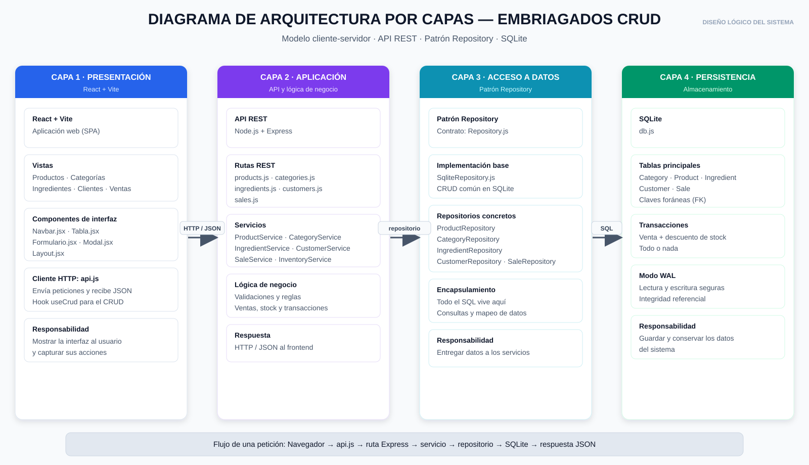
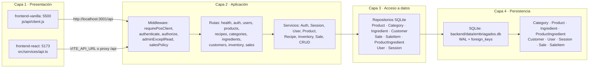

# Arquitectura por capas — POS Granizados / EMBRIAGADOS CRUD

Este documento describe la arquitectura implementada en la versión oficial del proyecto y su relación con el diagrama original. La ejecución usa `backend/` y los frontends `frontend-vanilla/` y `frontend-react/`. `App/` es la versión histórica/legacy, conservada pero no recomendada.



## Resumen

| Capa | Responsabilidad | Implementación |
| --- | --- | --- |
| 1. Presentación | Interfaz y captura de acciones | Vanilla (HTML/CSS/JS) y React + TypeScript + Vite + Tailwind |
| 2. Aplicación | HTTP, sesión, roles, reglas de negocio | Express, middleware de auth, rutas y servicios |
| 3. Acceso a datos | Consultas y mapeo | Patrón Repository sobre SQLite |
| 4. Persistencia | Datos y transacciones | SQLite (`better-sqlite3`), WAL, FK, `backend/data/embriagados.db` |

Flujo de una petición:

```text
Vanilla o React -> Fetch (credentials: include, x-pos-client)
                -> middleware (cliente, sesión, rol)
                -> ruta Express -> servicio -> repositorio -> SQLite
                <- JSON      <- servicio <- repositorio <- SQLite
```

## Diagrama actual



## Capa 1 — Presentación

- **Vanilla**: `frontend-vanilla/index.html`, `css/`, `js/api/client.js`, `js/pages/` y `js/main.js`. Sirve en `http://localhost:5500` y llama directamente a `http://localhost:3001/api`.
- **React**: `frontend-react/src/services/api.ts`, `hooks/`, `pages/`, `components/` y `types/`. Sirve en `http://localhost:5173`; usa `VITE_API_URL` (por defecto `http://localhost:3001/api`) o `/api` con el proxy de Vite al puerto 3001.

Ambos clientes:

- envían `credentials: 'include'` para que el navegador reenvíe la cookie `pg_session`;
- envían el header `x-pos-client: pos-granizados`;
- pueden guardar el usuario en `localStorage` solo para la UI; la autenticación real la decide el servidor validando la sesión en SQLite.

## Capa 2 — Aplicación

Archivos principales:

```text
backend/
├── app.js                 # CORS, health, middleware global y montaje de rutas
├── server.js              # arranca Express en PORT (3001 por defecto)
├── middleware/auth.js     # requirePosClient, authenticate, authorize,
│                          # adminExceptRead, salesPolicy
├── utils/http.js          # cookie pg_session, opciones y header de cliente
├── routes/                # auth, users, products, recipes, categories,
│                          # ingredients, customers, inventory, sales
└── services/              # Auth, Session, User, Product, Recipe, Inventory,
                           # Sale y CrudService
```

Orden relevante en `app.js`:

1. CORS con whitelist (`CORS_ORIGINS`, por defecto los puertos 5500 y 5173) y `credentials: true`.
2. `GET /api/health` público.
3. `requirePosClient` para POST/PUT/PATCH/DELETE: exige `x-pos-client: pos-granizados`.
4. Rutas de `/api/auth` (login público; `me` y `logout` validan sesión).
5. `authenticate` para el resto de `/api`: lee `pg_session` y la valida en la tabla `Session`.
6. Autorización por ruta:
   - `/api/users`: solo `admin`.
   - `/api/products`, `/api/categories`, `/api/ingredients`, `/api/customers`, `/api/inventory` y recetas: lectura para ambos roles; escritura solo `admin` (`adminExceptRead`).
   - `/api/sales`: lectura y creación para ambos roles; eliminación solo `admin` (`salesPolicy`).

### Servicios destacados

- `AuthService` y `SessionService`: login con password hasheado, creación de sesión con TTL, validación y logout.
- `UserService`: validación de roles `admin`/`cajero` y passwords hasheados; nunca devuelve `password`.
- `RecipeService`: valida ítems `{ingredientId, quantity}` y reemplaza la receta dentro de una transacción.
- `InventoryService`: valida stock, descuenta y restaura producto e ingredientes.
- `SaleService`: coordina venta, ítems e inventario en una transacción.

## Capa 3 — Acceso a datos

```text
backend/repositories/
├── Repository.js, SqliteRepository.js
├── ProductRepository.js, CategoryRepository.js, IngredientRepository.js
├── CustomerRepository.js, SaleRepository.js, SaleItemRepository.js
├── ProductIngredientRepository.js
├── UserRepository.js
└── SessionRepository.js
```

El patrón Repository concentra SQL, permite cambiar la fuente de datos sin tocar servicios y mantiene las rutas delgadas. `UserRepository` oculta passwords en listados y, al eliminar un usuario, en una transacción pone a NULL su `userId` en `Sale` y borra sus `Session`.

## Capa 4 — Persistencia

- Motor: SQLite con `better-sqlite3`, `journal_mode = WAL` y `foreign_keys = ON`.
- Ruta: `backend/data/embriagados.db` (configurable con `DB_PATH`).
- Tablas: `Category`, `Product`, `Ingredient`, `ProductIngredient`, `Customer`, `User`, `Session`, `Sale` y `SaleItem`.
- Migraciones defensivas: esquema `Sale` legacy a `Sale + SaleItem`, deduplicación de recetas y creación del índice único `idx_product_ingredient_pair`.
- Seed configurable: `SEED_ADMIN_USERNAME`, `SEED_ADMIN_PASSWORD` y `SEED_ADMIN_NAME`; desarrollo usa `admin / admin123`, producción exige las variables de usuario y password.
- La base oficial conserva 1 usuario y 5 productos tras la migración.

## Flujo de autenticación

1. El cliente hace `POST /api/auth/login` con `credentials: 'include'` y el header de cliente.
2. `AuthService` verifica password con PBKDF2; `SessionService` crea un registro en `Session` con expiración (`SESSION_TTL_HOURS`, 8 horas por defecto).
3. El servidor devuelve cookie `pg_session`: HttpOnly, `SameSite=lax`, `Secure` si `NODE_ENV=production` o `COOKIE_SECURE=true`.
4. En cada petición protegida, `authenticate` lee la cookie, valida existencia, expiración y usuario activo en SQLite.
5. `GET /api/auth/me` devuelve el usuario vigente; `POST /api/auth/logout` borra la sesión y la cookie.
6. Un valor en `localStorage` no autentica por sí mismo: si la sesión expira o se cierra, el backend responde 401.

## Recetas

- `GET /api/products/:productId/recipes` devuelve los ingredientes de la receta.
- `PUT /api/products/:productId/recipes` recibe `{items:[{ingredientId,quantity}]}`.
- `RecipeService` valida producto existente, ingredientes existentes, cantidades positivas y ausencia de duplicados; borra la receta anterior y escribe la nueva en una sola transacción. Si falla una validación, no se modifica nada.

## Flujo de una venta

1. El cliente envía `POST /api/sales` con `credentials: 'include'` y el header de cliente.
2. `salesPolicy` permite el acceso a `admin` y `cajero`; el backend asocia `userId` desde la sesión.
3. `SaleService` valida datos y abre una transacción.
4. `InventoryService` verifica stock del producto y de los ingredientes de su receta.
5. Se insertan `Sale` y `SaleItem` y se descuentan producto e ingredientes.
6. Si algo falla, SQLite revierte venta, ítems y descuentos. Al eliminar la venta se ejecuta el proceso inverso y se restaura el stock.

## Seguridad

- CORS restringido a los orígenes configurados; otros orígenes quedan bloqueados.
- Header `x-pos-client` obligatorio para operaciones de escritura.
- Autenticación global y autorización por rol en el servidor, no solo en la interfaz.
- Cookie HttpOnly + SameSite=lax + Secure en producción; passwords con PBKDF2 y sin exposición en respuestas.
- Borrado de usuarios limpia ventas y sesiones para no dejar referencias huérfanas.

## Pruebas

La suite `cd backend && npm test` cubre health, auth (login/me/logout), seguridad de cliente y sesión, roles, usuarios, catálogos, inventario, recetas, ventas con descuento/restauración, stock insuficiente, reversión transaccional y CORS.

Resultado verificado: **17 pruebas, 17 pass, 0 fail**. React también pasó `typecheck`, `lint` y `build`. La verificación visual simultánea en navegador se completó con Chrome headless sobre los tres servicios reales.
